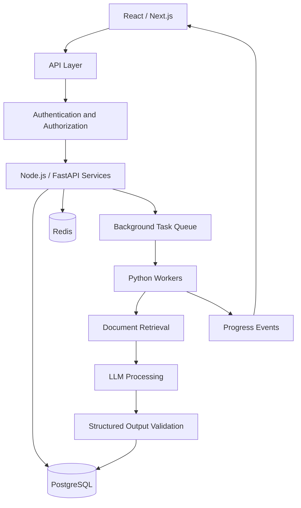

<div align="center">


<a href="https://www.linkedin.com/in/kevin-pham-48a2ab452/"></a>
<a href="mailto:kevindev731@gmail.com"></a>

</div>

---

## `>` About me

I'm a senior full-stack software engineer focused on building scalable web applications, reliable backend services, and AI-powered software. My experience spans life sciences, enterprise software, fintech, and AI-powered SaaS.

I work across the entire software development lifecycle — from architecture and implementation to automated testing, deployment, and production support. I care about clean interfaces, maintainable code, secure data processing, and systems that solve meaningful business problems.

```ts
const engineer = {
  name: "Kevin Pham",
  role: "Senior Full-Stack Software Engineer",
  location: "Garden Grove, California",
  experience: "11+ years",
  languages: ["TypeScript", "JavaScript", "Python", "SQL"],
  frontend: ["React", "Next.js", "Vue.js"],
  backend: ["Node.js", "NestJS", "FastAPI", "Django"],
  databases: ["PostgreSQL", "MongoDB", "Redis", "MySQL"],
  focus: ["AI Applications", "Distributed Systems", "Cloud Architecture"],
  principles: ["Maintainability", "Reliability", "Security"]
} as const;
```

## `>` What I build

| Frontend engineering | Backend & distributed systems | AI engineering |
|---|---|---|
| Responsive React applications | REST and GraphQL APIs | LLM integration |
| Next.js and server-side rendering | Event-driven services | Retrieval-augmented generation |
| Reusable component architecture | Asynchronous processing | AI research assistants |
| Interactive analytical dashboards | Real-time WebSocket services | Document ingestion and processing |
| State management and performance | Database design and caching | Structured outputs and AI agents |

## `>` Technology stack

<div align="center">

**Languages & Frontend**


**Backend & APIs**


**Data & Messaging**


**AI & LLM Engineering**


**Cloud & DevOps**


**Testing & Quality**


</div>

---

## `>` AI application architecture

An illustrative architecture for an asynchronous, retrieval-augmented research application:



<details>
<summary><b>Frontend architecture and performance</b></summary>

- Reusable components and predictable state management
- Server-side rendering, lazy loading, and code splitting
- Responsive interfaces and interactive data visualization
- Efficient data fetching and rendering

</details>

<details>
<summary><b>Backend reliability and security</b></summary>

- RESTful and GraphQL API design
- Asynchronous workers and event-driven processing
- PostgreSQL query optimization and Redis caching
- OAuth2, JWT, role-based access control, and input validation

</details>

<details>
<summary><b>AI-powered research workflows</b></summary>

- Document ingestion and retrieval-augmented generation
- Natural language research interfaces and summarization
- Structured model outputs and asynchronous task processing
- Real-time visibility into long-running AI tasks

</details>

## `>` Professional background

| Domain | Engineering focus |
|---|---|
| AI-powered life sciences | Research workflows, document processing, analytical dashboards |
| Enterprise software | Full-stack architecture, integrations, distributed services |
| Fintech | Digital lending, secure customer portals, financial workflows |

**Education:** Bachelor's degree in Computer Science — University of California, Irvine (UCI).

## `>` Engineering principles

- Build for maintainability, not just immediate delivery.
- Measure performance before optimizing.
- Keep security and data privacy integral to system design.
- Validate AI outputs before consuming them downstream.
- Automate testing and deployment wherever practical.
- Make technical decisions with clear, documented trade-offs.

## `>` Connect

<div align="center">

Interested in full-stack engineering, AI-powered products, and scalable software architecture.

<a href="mailto:kevindev731@gmail.com"></a>
<a href="https://www.linkedin.com/in/kevin-pham-48a2ab452/"></a>


</div>
