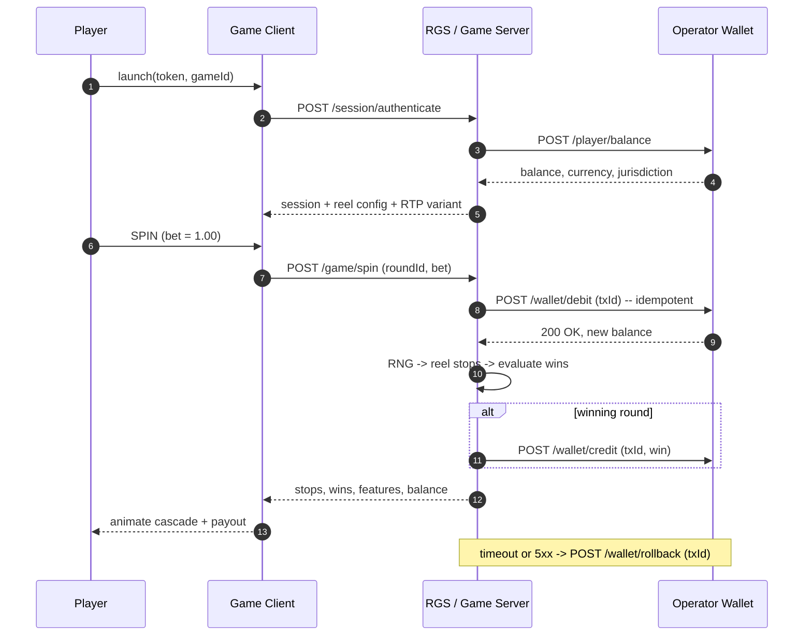

<div align="center">


<a href="https://github.com/sgnihttcejbo">
  
</a>

<br/>


</div>

---

## `>` whoami

```ts
const dev: iGamingEngineer = {
  role:       "Slot Game Developer & Gaming API Provider",
  focus:      ["Reel Math Models", "Remote Gaming Server", "Seamless Wallet APIs"],
  engines:    ["PixiJS", "Phaser 3", "Unity", "Spine 2D", "WebGL"],
  backend:    ["Node.js", "Go", "Rust", "PostgreSQL", "Redis", "Kafka"],
  certified:  ["GLI-19", "iTech Labs", "BMM Testlabs"],
  markets:    ["MGA", "UKGC", "Curacao", "Anjouan", "Kahnawake"],
  currently:  "Cluster-pays engine evaluating 100k+ ways in under 8ms",
  philosophy: "The math model is the product. Everything else is presentation."
};
```

I ship **certifiable, audit-ready casino software** — from the reel-strip spreadsheet all the way to the
operator's `/bet` endpoint. Not demos. Production systems that settle real money, survive regulator
scrutiny, and don't fall over on a Saturday-night traffic spike.

---

## `>` what I build

<table>
<tr>
<td width="33%" valign="top">

### 🎰 Slot Engines

Reel strips • Paylines • Ways<br/>
Cluster Pays • Megaways-style<br/>
Hold &amp; Win • Cascading / Tumble<br/>
Expanding &amp; Sticky Wilds<br/>
Free Spin retriggers<br/>
Buy-Feature / Ante Bet<br/>
Multi-level Jackpots

</td>
<td width="33%" valign="top">

### 🧮 Math &amp; Certification

RTP modelling (88–98%)<br/>
Volatility index tuning<br/>
Hit frequency analysis<br/>
Monte Carlo @ 10B spins<br/>
PAR sheets &amp; math docs<br/>
Cycle &amp; max-win validation<br/>
Lab submission packs

</td>
<td width="33%" valign="top">

### 🔌 Platform &amp; APIs

RGS (Remote Gaming Server)<br/>
Seamless / Transfer wallet<br/>
Aggregator integrations<br/>
Bonus &amp; free-round engine<br/>
Tournaments &amp; leaderboards<br/>
Affiliate + agent hierarchy<br/>
Back-office &amp; reporting

</td>
</tr>
</table>

---

## `>` the stack

<div align="center">

**Game Client**


**Game Server / RGS**


**Data &amp; Infra**


**Crypto / Web3 Casino**


</div>

---

## `>` seamless wallet integration

Every operator asks the same question: *"how fast can you integrate?"*
Answer: one API key, four endpoints, idempotent by design.



**Integration contract at a glance**

| Endpoint | Method | Guarantee |
|---|:---:|---|
| `/wallet/balance` | `POST` | Read-only, 500 ms cache |
| `/wallet/debit` | `POST` | Idempotent on `txId`, single-flight per round |
| `/wallet/credit` | `POST` | Idempotent, replay-safe, always settles |
| `/wallet/rollback` | `POST` | Compensating tx, safe to call N times |
| `/game/launch` | `GET` | Signed URL, 60 s TTL, jurisdiction-aware |

> **Reliability contract:** every money movement is a state machine persisted *before* the network call.
> A crash mid-round replays to the exact same outcome, because the RNG seed is committed before the debit.

---

## `>` provably fair (crypto casinos)

```ts
import { createHmac, createHash } from "node:crypto";

/**
 * Deterministic reel stops from a committed server seed.
 * Player verifies post-round: sha256(serverSeed) === publishedHash
 */
export function spinOutcome(
  serverSeed: string,
  clientSeed: string,
  nonce: number,
  reels: readonly number[]      // strip length per reel
): number[] {
  const digest = createHmac("sha256", serverSeed)
    .update(`${clientSeed}:${nonce}`)
    .digest();

  // Rejection sampling, never a naive `% len` — modulo bias skews the
  // distribution and a competent auditor will fail the submission for it.
  return reels.map((len, i) => unbiased(digest, i * 4, len));
}

export const commit = (serverSeed: string) =>
  createHash("sha256").update(serverSeed).digest("hex");
```

<div align="center">

**`commit` → `play` → `reveal` → `verify`** — the player can audit every spin they ever made.

</div>

---

## `>` math model showcase

| Model | Mechanic | Grid | RTP band | Volatility | Max Win | Hit Freq. |
|---|---|:---:|:---:|:---:|:---:|:---:|
| **Solar Blaze** | Ways + Hold &amp; Win | 5×3 | 96.21 / 94.5 / 88.0 | ★★★☆☆ | 5,000× | 28.4% |
| **Reef Cascade** | Cluster + Tumble | 7×7 | 96.48 / 94.2 | ★★★★☆ | 12,500× | 22.1% |
| **Dragon Ways X** | 117,649 Ways | 6×7 | 96.05 / 93.9 | ★★★★★ | 50,000× | 19.7% |
| **Fortune Vault** | Hold &amp; Win + Jackpot | 5×4 | 95.90 / 94.0 | ★★★★☆ | 8,000× | 31.2% |
| **Neon Streak** | Expanding Wilds | 5×3 | 96.70 | ★★☆☆☆ | 2,000× | 36.8% |

<sub>Every model ships with a PAR sheet, a 10B-spin Monte Carlo report, cycle validation, and a lab submission pack.</sub>

<!-- Swap these rows for your real titles, and link each name to its repo or demo. -->

---

## `>` platform capabilities

<details>
<summary><b>🎁 Bonus &amp; Promotion Engine</b></summary>

- Free spins — game-locked, value-locked, wager-locked
- Deposit match / cashback / reload with rollover tracking
- Wagering contribution weights per game category
- Bonus-abuse detection (bet-pattern + velocity heuristics)
- Expiry, forfeiture and partial-conversion rules engine

</details>

<details>
<summary><b>💰 Jackpot Systems</b></summary>

- Progressive: standalone, local pool, wide-area network
- Multi-tier Mini / Minor / Major / Grand
- Contribution accounting with seed + reserve split
- Must-drop-by, triggered on time or amount
- Atomic award with exactly-once settlement

</details>

<details>
<summary><b>🏆 Tournaments &amp; Engagement</b></summary>

- Real-time leaderboards on Redis sorted sets, sub-millisecond updates
- Scoring by total win, biggest multiplier, spin count or streak
- Prize-pool distribution with automatic settlement
- Missions, quests, daily wheels and loyalty tiers

</details>

<details>
<summary><b>🛡️ Compliance &amp; Responsible Gaming</b></summary>

- Reality-check timers, session limits, forced breaks
- Deposit / loss / wager limits with cool-off enforcement
- Self-exclusion registries and jurisdiction geo-blocking
- KYC/AML hooks, PEP and sanctions screening
- Full audit trail — every round reconstructible for a regulator
- Per-market autoplay restrictions (UKGC compliant)

</details>

<details>
<summary><b>📊 Back-Office &amp; Analytics</b></summary>

- GGR / NGR / hold% dashboards per game and per brand
- Player lifetime value, churn and cohort analysis
- Real-time RTP drift monitoring with alerting
- Agent and affiliate hierarchies with revenue-share automation
- ClickHouse-backed reporting over billions of rounds

</details>

---

## `>` engineering principles

```
1. The RNG is certified, isolated, and never touched by game logic.
2. Money moves through a state machine, never through an if-statement.
3. Every round is reconstructible from the event log. Every one.
4. Idempotency keys on all writes — the network will betray you.
5. RTP is validated by simulation, not by hope.
6. Responsible gaming is a requirement, not a checkbox.
```

---

## `>` stats

<div align="center">


</div>

---

## `>` let's build

<div align="center">

Need a **slot game**, a **turnkey RGS**, or an **aggregator integration** that passes certification first time?

<a href="mailto:cashblaze129@gmail.com">
  
</a>
<a href="https://t.me/">
  
</a>
<a href="https://www.linkedin.com/">
  
</a>
<a href="https://discord.com/">
  
</a>

<!-- Replace the placeholder hrefs above with your real Telegram / LinkedIn / Discord links. -->

<br/><br/>

<sub>🔞 Everything I build targets <b>licensed operators in regulated markets</b> and ships with
responsible-gambling controls enabled by default. Gambling is entertainment, never a strategy —
if it stops being fun, take a break: <a href="https://www.begambleaware.org/">BeGambleAware.org</a></sub>


</div>
